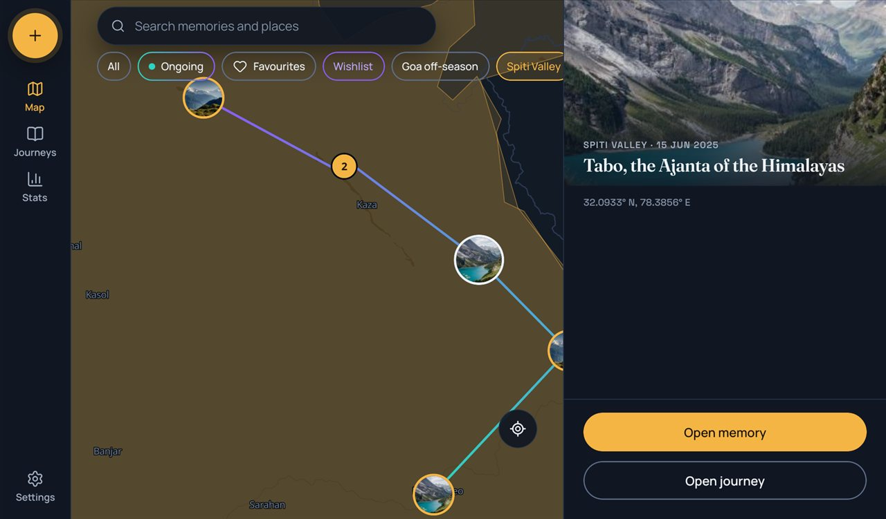
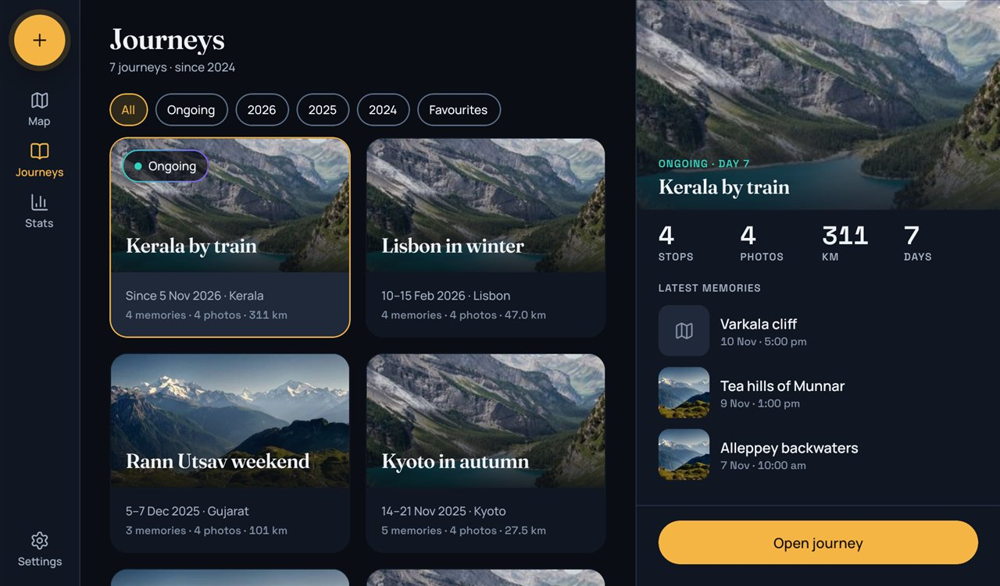
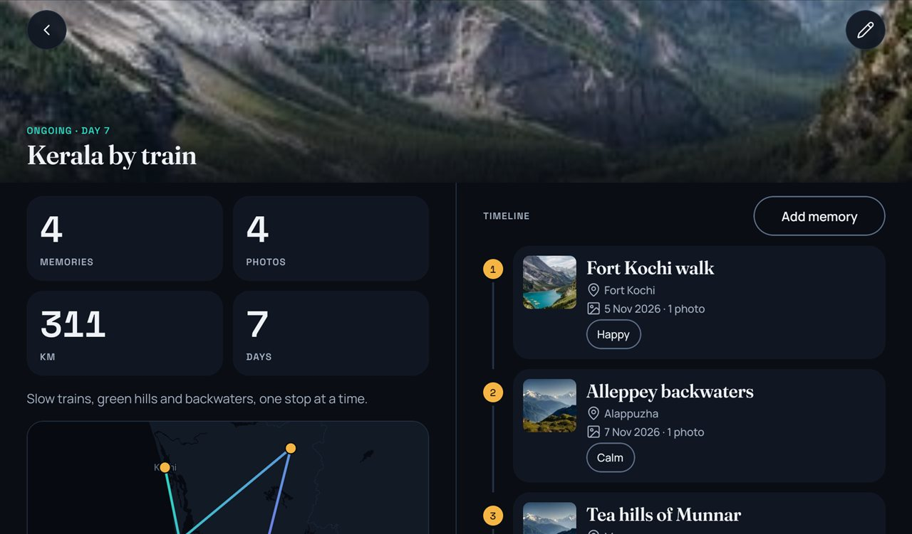
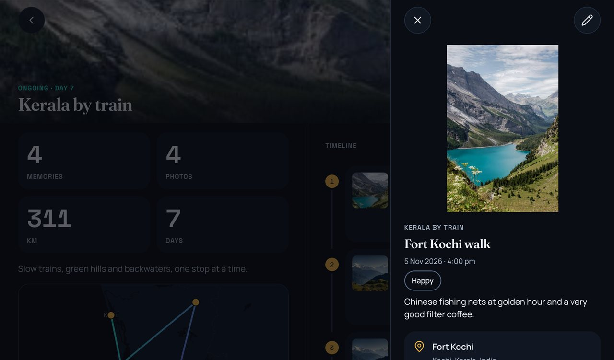
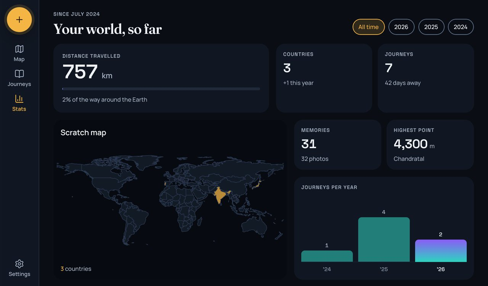
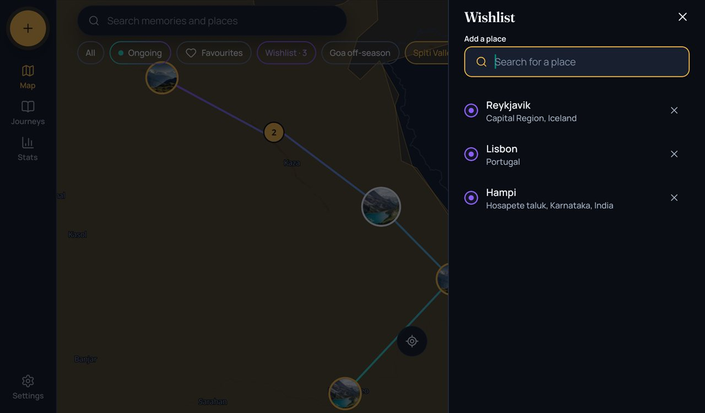
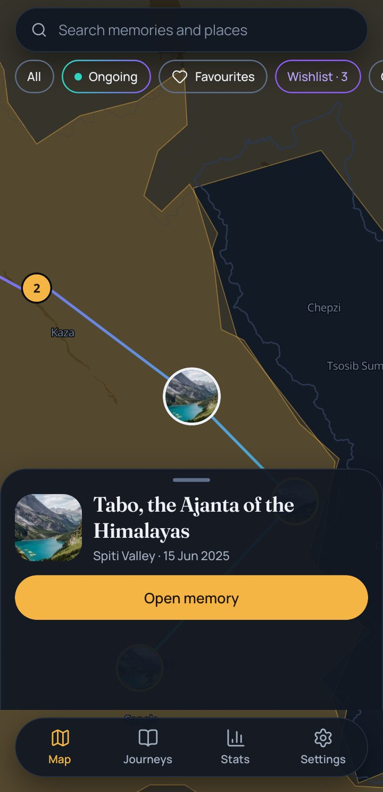
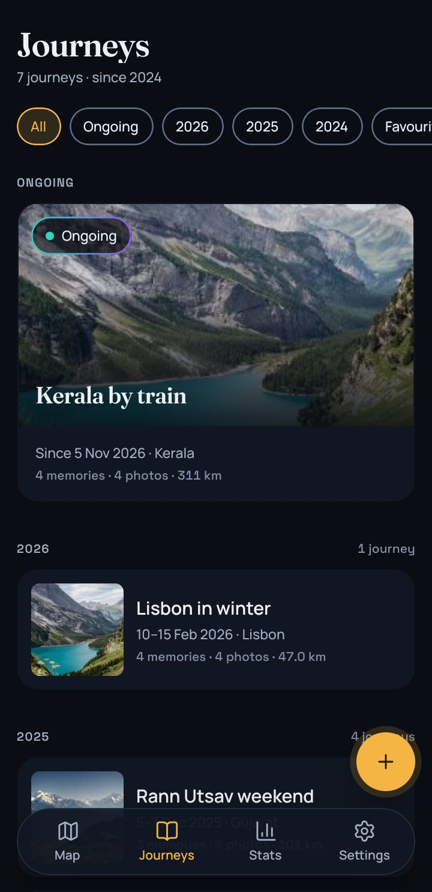
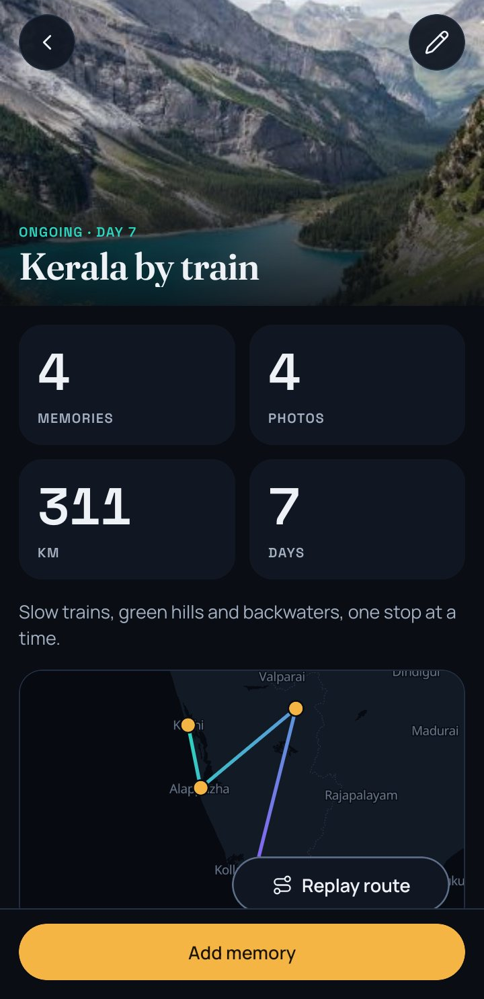
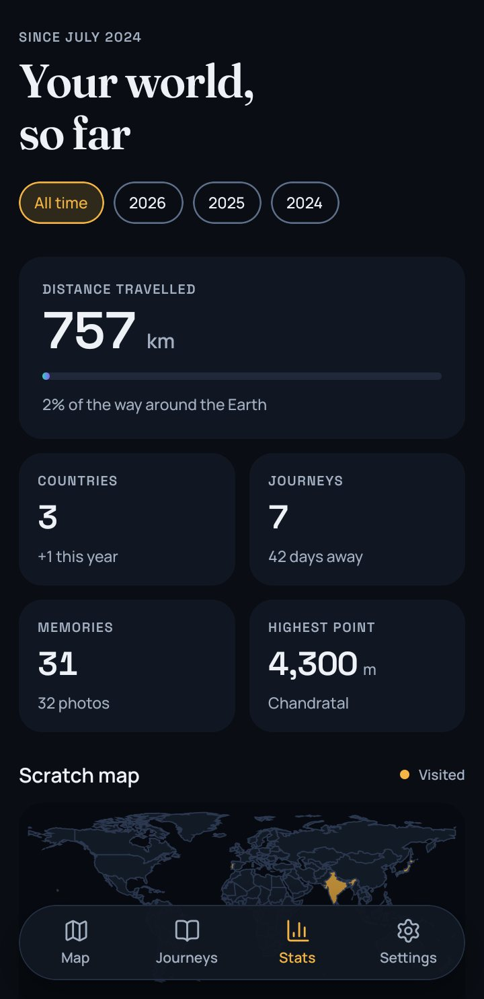

# Atlaslight

An offline-first travel journal. Record journeys, attach memories (photos, videos, notes, moods) to places, and watch one dark world map fill with amber pins and aurora routes. Everything is stored on the device: no backend, no accounts, no sync. Portfolio project for React Native roles. Full details: [docs/project-spec.md](docs/project-spec.md).

## Screenshots

Tablet (landscape, with side panels) and phone, from the release build with the demo journeys loaded. The layout follows the window size: phones get a floating tab bar and bottom sheets, wider windows a rail and a right-hand panel.

| Map                                                                                                     | Journeys                                                                                        |
| ------------------------------------------------------------------------------------------------------- | ----------------------------------------------------------------------------------------------- |
|            |                    |
| **Journey detail**                                                                                      | **Memory detail**                                                                               |
|                     |  |
| **Stats**                                                                                               | **Wishlist**                                                                                    |
|  |                        |

| Map                                                              | Journeys                                                    | Journey detail                                              | Stats                                            |
| ---------------------------------------------------------------- | ----------------------------------------------------------- | ----------------------------------------------------------- | ------------------------------------------------ |
|  |  |  |  |

## What it does

- **Journeys**: create, edit, favourite and delete journeys. One journey can be ongoing (no end date).
- **Memories**: add photos, videos, a note, a mood, a place and a time. Drag to reorder the route.
- **Found in your photos**: fills in a memory's place and time from a photo's location data.
- **Map**: a dark map with amber pins, photo pins and clusters when zoomed in, aurora route lines, visited countries and states filled in, your live location, and wishlist pins.
- **Journey detail**: cover, numbers, a route map with **Replay route**, and a timeline.
- **Memory detail**: photo and video pager, place, mood, note and a small map.
- **Stats**: distance travelled, countries, journeys per year, highest point and a world scratch map.
- **Wishlist**: places you want to visit, shown as violet pins.
- **On this day**: a memory from the same date in a past year.
- **Settings**: display name, km or miles, map toggles, backup and restore, demo journeys, delete all data.

## Works offline

Everything works without a network except map tiles and place search. Photos, videos and the database stay on the device. There is no analytics and nothing is uploaded.

- **Visited countries and Indian states** are worked out on the device from two bundled map files, so they are available from the first launch.
- **Stats** are calculated on the device. Distance is the straight-line (great-circle) length along each journey's route, added up. A journey counts for the year it starts in.
- **Location** is asked only when you tap Locate, and only while the app is open. It is never stored or sent anywhere.
- **Altitude** can be saved with a memory (from a photo, the photo library or a location fix) and is used for your highest point.

## Backup and data

- **Back up to a file** saves your whole journal, photos and videos included, as one zip you choose where to keep.
- **Restore from a file** checks the whole backup first, then replaces your journal in one step. If anything fails, your journal stays exactly as it was.
- **Delete all data** asks first and states what will be removed. Settings are kept.
- **Load demo journeys** adds 7 sample journeys with photos. Running it again adds nothing twice.

## Built with

React Native (new architecture, Hermes) and TypeScript, SQLite with Drizzle ORM read through RTK Query, Redux Toolkit for settings and UI state, React Navigation, MapLibre for maps, Reanimated and Gesture Handler for motion, FlashList for lists, and Jest for the pure-logic tests.

## Performance

Measured on one Android tablet (90 Hz) with the release build, holding 1,031 memories in 27 journeys:

| What                                                    | Result                              |
| ------------------------------------------------------- | ----------------------------------- |
| Cold start                                              | median 514 ms                       |
| APK size (arm64 only)                                   | 50.7 MB                             |
| Map pins query, 1,031 memories                          | 108 ms                              |
| Map pan at world zoom with 1,031 pins, clusters, routes | 11.1 ms per frame (the 90 Hz limit) |
| Journeys grid scroll, 27 cards                          | 0.7% janky frames                   |

Not measured: photo pins at high zoom with 1,000 dots, a real phone, iOS.

## Data sources and licences

| What                                                                       | Used for                           | Licence and terms                                                                        |
| -------------------------------------------------------------------------- | ---------------------------------- | ---------------------------------------------------------------------------------------- |
| [OpenFreeMap](https://openfreemap.org/)                                    | Map tiles, glyphs                  | Free, no key; map data © OpenStreetMap contributors (ODbL)                               |
| [Photon](https://photon.komoot.io/) by Komoot                              | Place search and reverse lookup    | OpenStreetMap data (ODbL); public instance, fair use (searches are debounced and cached) |
| [Natural Earth](https://www.naturalearthdata.com/)                         | Countries and Indian states shapes | Public domain                                                                            |
| [MapLibre React Native](https://github.com/maplibre/maplibre-react-native) | Map view                           | MIT                                                                                      |
| Fraunces, Manrope, Space Grotesk                                           | Fonts                              | SIL Open Font License 1.1                                                                |
| [Lucide](https://lucide.dev/) icons                                        | Icons                              | ISC                                                                                      |
| Demo photos (`src/assets/demo/photos/`)                                    | Sample journeys                    | Source and licence to be added                                                           |

The app icon's source is not recorded yet. The project itself has no licence file yet.

## Docs

- [docs/project-spec.md](docs/project-spec.md): what the app does, data model, screens, rules, phases
- [docs/design-brief.md](docs/design-brief.md): visual direction
- [docs/ARCHITECTURE.md](docs/ARCHITECTURE.md): layers, data flow, state rules
- [docs/CONVENTIONS.md](docs/CONVENTIONS.md): naming, imports, tags, git
- [docs/ADDING_A_FEATURE.md](docs/ADDING_A_FEATURE.md): recipe for a new screen with data
- [docs/PROGRESS.md](docs/PROGRESS.md), [docs/PLANNING_TEMPLATE.md](docs/PLANNING_TEMPLATE.md): planning and tracking
- [docs/AI_TOOLING.md](docs/AI_TOOLING.md): Claude Code skills, MCP servers, workflow
