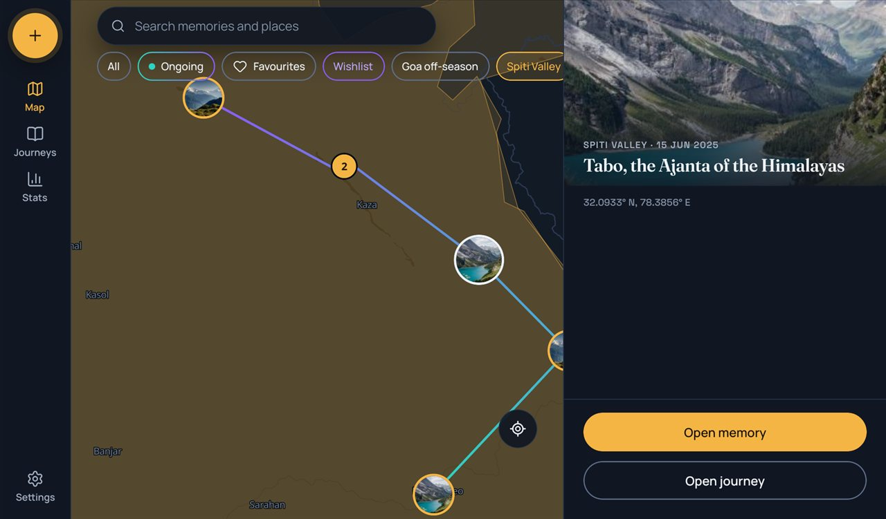
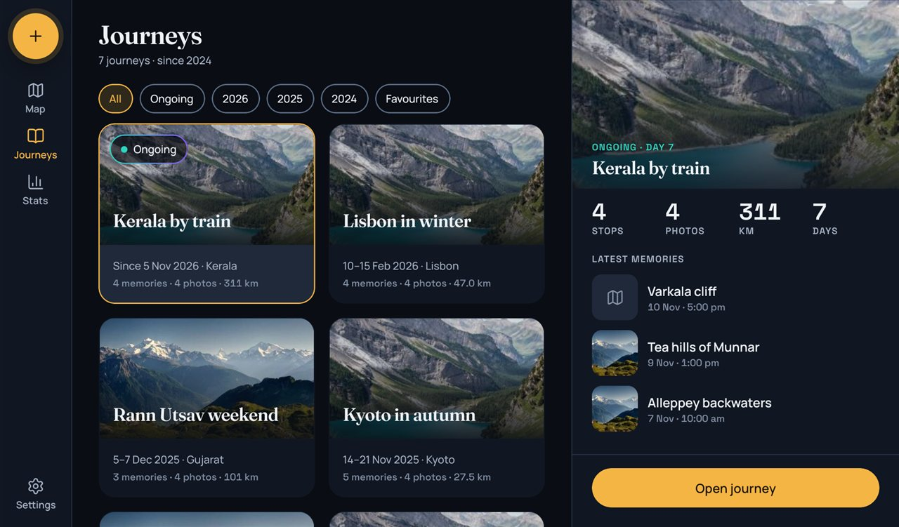
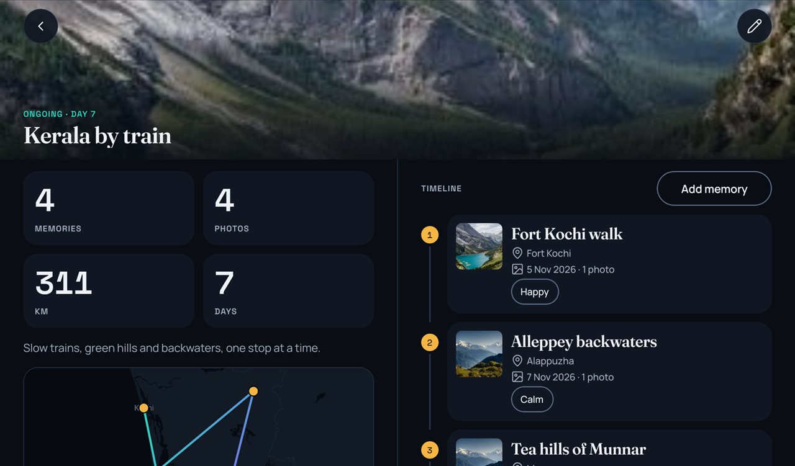
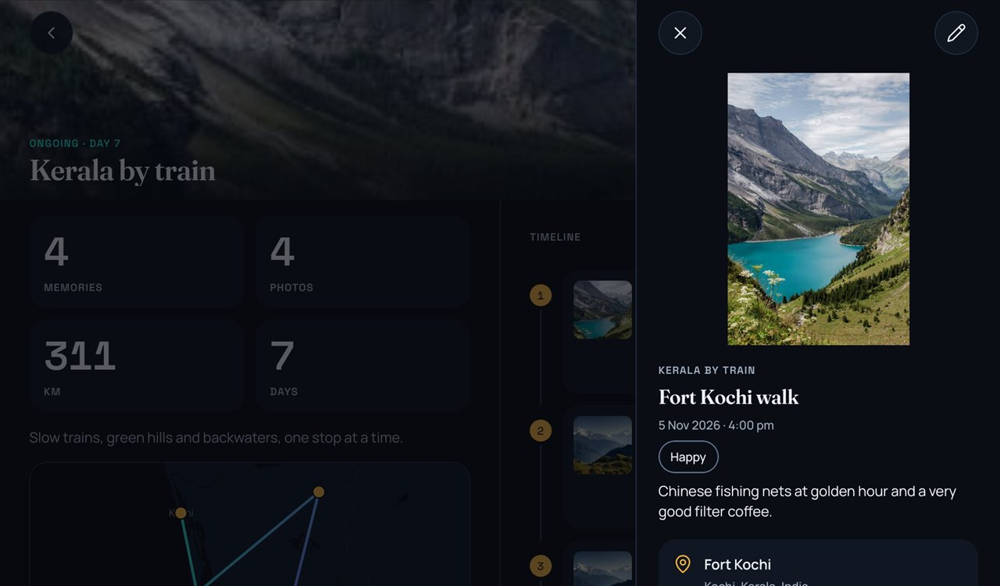
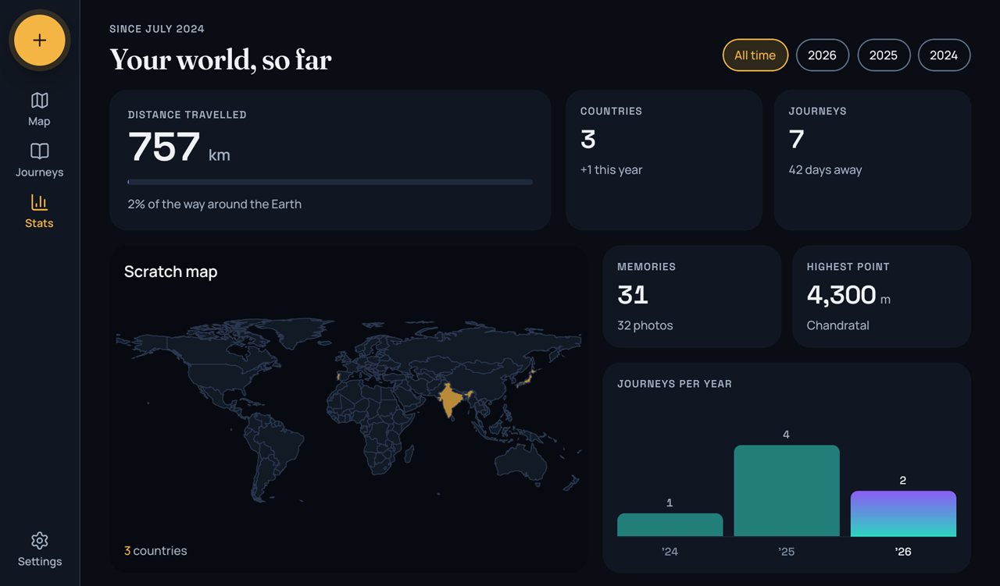
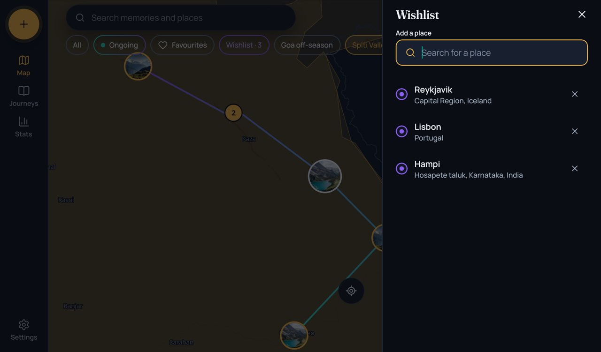
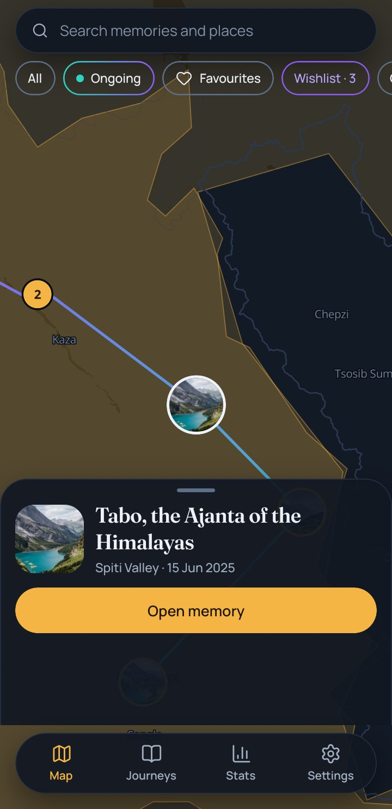
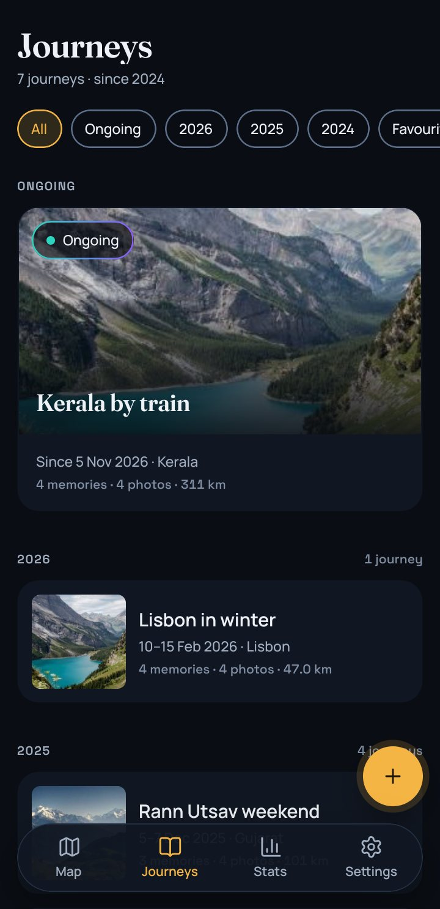
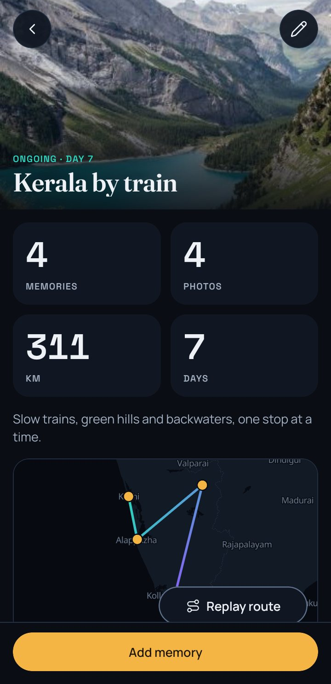
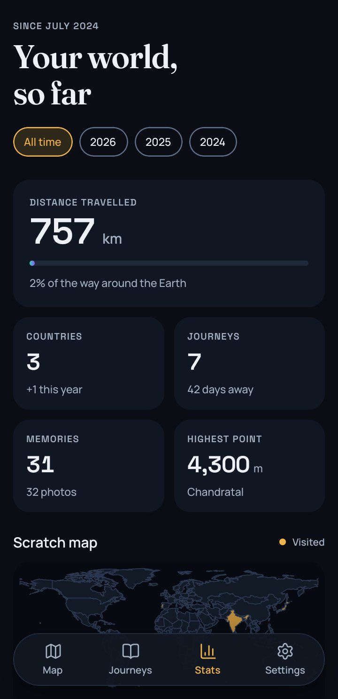

# Atlaslight

An offline-first travel journal. Record journeys, attach memories (photos, videos, notes, moods) to places, and watch one dark world map fill with amber pins and aurora routes. Everything is stored on the device: no backend, no accounts, no sync. Portfolio project for React Native roles. What it does: [docs/project-spec.md](docs/project-spec.md).

## Screenshots

Taken on a tablet (landscape, with the side panels) and on a phone-size screen, from the release build with the demo journeys loaded. The layout follows the window size, not the device: phones get a floating tab bar and bottom sheets, wider windows a rail and a right-hand panel.

| Map                                                                                                     | Journeys                                                                                        |
| ------------------------------------------------------------------------------------------------------- | ----------------------------------------------------------------------------------------------- |
|            |                    |
| **Journey detail**                                                                                      | **Memory detail**                                                                               |
|                     |  |
| **Stats**                                                                                               | **Wishlist**                                                                                    |
|  |                        |

| Map                                                              | Journeys                                                    | Journey detail                                              | Stats                                            |
| ---------------------------------------------------------------- | ----------------------------------------------------------- | ----------------------------------------------------------- | ------------------------------------------------ |
|  |  |  |  |

## Stack

| Part     | Choice                                                                                                          |
| -------- | --------------------------------------------------------------------------------------------------------------- |
| App      | React Native 0.88.1 (new architecture, Hermes), React 19.3.0                                                    |
| Language | TypeScript 5.9.3, strict                                                                                        |
| Data     | SQLite (op-sqlite) + Drizzle ORM, read and written through RTK Query (`queryFn`)                                |
| State    | Redux Toolkit 2 + react-redux 9 + redux-persist 6 (UI and settings state)                                       |
| Navigate | React Navigation 7 (native stack + bottom tabs)                                                                 |
| Storage  | AsyncStorage 3 (persisted settings), app documents directory (media files)                                      |
| Media    | react-native-image-crop-picker, camera-roll (photo locations), react-native-fs, create-thumbnail, image-resizer |
| UI       | reanimated 4, gesture-handler, gorhom bottom-sheet, svg, lucide icons                                           |
| Lists    | FlashList 2, react-native-reorderable-list (timeline drag reorder)                                              |
| Forms    | react-hook-form + zod, datetimepicker, date-fns                                                                 |
| Viewing  | react-native-video 6, fast-image (photo and video display), @turf/distance                                      |
| Tests    | Jest (pure logic only)                                                                                          |
| Tooling  | ESLint 9 (flat config) + Prettier 3, `@/` absolute imports (babel module-resolver)                              |
| Package  | Yarn classic (1.x), Node >= 22.11                                                                               |

## Setup from zero (Windows 11, Android physical phone)

1. Install Node 22 LTS, Yarn classic (`npm i -g yarn`), JDK 17, Android Studio, and Git.
2. In Android Studio's SDK Manager install: Android SDK Platform 37, Build-Tools 37.0.0, NDK 27.1.12297006, Platform-Tools. Set `ANDROID_HOME` to the SDK folder and add `platform-tools` to `PATH`.
3. On the phone: enable Developer options, turn on USB debugging, connect over USB and accept the prompt. Check with `adb devices`.
4. `yarn install`
5. `yarn start` in one terminal (Metro), `yarn android` in another. No environment file is needed.

The Settings tab has **Load demo journeys**: it adds 7 sample journeys with photos (run it again and nothing is duplicated). In the memory form, **Found in your photos** asks for photo access (and photo locations) the first time it is used; the system photo picker hides GPS, so places come from that card or from place search. Dev builds add three buttons to the Settings tab, none of them in release builds: **Open UI kit** (`src/screens/KitScreen`, a gallery of the UI components), **Load 1,000 test memories** (20 generated journeys of 50 memories over 40 cities, for performance checks; run it again and nothing is duplicated) and **Remove test memories**.

The Map tab uses MapLibre with OpenFreeMap vector tiles (no API key). Tiles need a network connection the first time; the map shows no attribution button (owner decision). Journey detail shows the journey's own route map (`components/map/JourneyRouteMap.tsx`); Replay route redraws the line over 6 seconds. The map there is fixed (no pan or zoom, so it never fights the page scroll); tap a dot to open the memory. Memory detail has a small fixed map of the place. In the memory form the place can come from search, **My location** (one position fix, asked only when you tap it) or **Pick on map** (`screens/MapPickScreen`: pan the map under the fixed mark, then Use this spot).

After adding a native module, a font or a demo photo, rebuild with `yarn android`; a Metro reload is not enough. Fonts live in `src/assets/fonts/` and the demo photos in `src/assets/demo/photos/` (lowercase `demo_<name>.jpg`, one flat resource namespace); both are linked with `npx react-native-asset`. iOS (Mac only): `bundle install`, `cd ios && bundle exec pod install`, then `yarn ios`. The iOS project has not been built.

## Map data

Visited countries and Indian states/UTs are worked out on the device from two bundled files in `src/assets/geo/` (point-in-polygon, no network), so they work offline from the first launch:

- `countries.json`: [Natural Earth](https://www.naturalearthdata.com/) 1:50m admin-0 countries (public domain), reduced to `{ iso2, name }`. Natural Earth marks France and Norway `-99`; `ISO_A2_EH` is used for those, and Somaliland, N. Cyprus and Siachen Glacier are mapped to SO, CY and IN by hand.
- `indiaStates.json`: Natural Earth 1:10m admin-1, India only (36 states and union territories, including Ladakh), reduced to `{ name }`. Natural Earth draws borders in its default de facto view.

Both are simplified to keep them small (about 470 KB and 85 KB). To regenerate (for example after a new Natural Earth release): download `ne_50m_admin_0_countries.geojson` and `ne_10m_admin_1_states_provinces.geojson` from the [natural-earth-vector](https://github.com/nvkelso/natural-earth-vector) repo, keep only the properties above (India = features with `iso_a2 = IN`), then run `npx mapshaper <in>.geojson -simplify 25% keep-shapes -o countries.json format=geojson precision=0.001` (15% for the India file). Nothing is downloaded by the app.

The Stats scratch map draws the countries file as SVG (world only), so it works offline too.

## Live location

Location is asked only when you tap the Locate button on the Map, and only while the app is open: the position is followed while the Map tab is showing and the GPS stops when you leave it. There is no background location, nothing is stored and nothing leaves the device. Permissions are `ACCESS_FINE_LOCATION` and `ACCESS_COARSE_LOCATION` (Android manifest) and the location text in `Info.plist`; the code is `src/services/location.service.ts`.

A memory can also keep its height above sea level (metres, optional). It comes from a photo's EXIF, from the photo library, or from a Locate fix in the memory form, and it stays on the device; the Stats screen uses it for your highest point.

## Stats

The Stats tab is worked out on the device from your journeys and memories, with no network. `src/utils/stats.util.ts` holds the maths (tested); `src/api/stats.api.ts` reads the data and looks up each memory's country once per change. Stats is world-only for version 1: no per-country or India-specific numbers.

- **Distance** is the great-circle length along each journey's route order, summed over journeys. The Earth bar compares it with 40,075 km; the unit follows the km / mi setting.
- **Countries** come from the bundled countries file (see Map data).
- **Year chips**: a journey counts for the year it starts in. "+N this year" counts countries first visited in that year, measured against every memory ever.
- **Highest point** is the highest memory that has an altitude (see Live location); the tile is hidden when none does.
- **Layouts**: windows 900 dp and wider get a 2-column dashboard, narrower ones a single column (centred and capped at 640 dp).

## Settings

The Settings tab keeps a display name (stored on the device only), the distance unit (km or mi, read by Stats and the journey lists) and three Map toggles (visited regions, journey routes, photo pins). They live in the persisted `settings` slice, so they survive restarts; saved settings are merged over the defaults, so a setting added later starts at its default on an existing install. It also shows photo and location permission status with a shortcut to the system settings page, the database and media sizes (`src/services/storageInfo.service.ts`), Load demo journeys, the source link and the version (`src/utils/appInfo.util.ts`; keep `APP_VERSION` equal to `versionName` in `android/app/build.gradle`). Wider windows get the same single column, centred and capped at 640 dp. Back up to a file (Backup section) reads every row, packs the media and thumbnail folders as inner zips and bundles them with `manifest.json` and `data.json` into `atlaslight-backup-<date>.zip` in the cache folder (format and checks in `src/utils/backup.util.ts`; `src/services/backup.service.ts` builds the file), then opens the system Save as dialog so you choose the folder; dismissing the dialog is not an error and the cached copy is always deleted. Settings are not part of a backup. Restore from a file picks a backup, checks all of it before anything changes (version, counts, references, safe paths, every media file present), shows what it holds and asks, then replaces the whole journal in one step: the rows in one database transaction and the media folders by renaming just before the commit, so a failed restore leaves your journal and photos exactly as they were. The picked file is copied to the cache and unpacked into a staging folder that is always removed afterwards. Delete all data (last section) asks first and states what goes (journeys, memories, photos and videos, the saved-places cache and the wishlist, with the files); rows are deleted before files, the query cache and the Map, Journeys and Stats selections are reset, and your settings stay. The Wishlist (violet chip on the Map, a row in Settings > Map) is a list of places to visit: search a place (Photon, needs a connection), tap a result to add it, tap X to remove it; `src/api/wishlist.api.ts` reads and writes it, the Map draws each place as a violet ring under the memory pins, and Stats shows the newest three under "Next on your wishlist". The same town within about 11 km counts as already listed. Phones get a full screen, wider windows a right-hand panel.

## Database

Schema is in `src/db/schema/`. After a schema change run `yarn db:generate`, which writes a migration into `src/db/migrations/`; `DatabaseProvider` applies migrations at startup. After the first generate or a migration change, restart Metro with `yarn start --reset-cache`.

## Scripts

| Script              | What it does                 |
| ------------------- | ---------------------------- |
| `yarn start`        | Metro bundler                |
| `yarn android`      | Build and run on Android     |
| `yarn ios`          | Build and run on iOS         |
| `yarn lint`         | ESLint                       |
| `yarn typecheck`    | `tsc --noEmit`               |
| `yarn test`         | Jest (pure-logic tests)      |
| `yarn db:generate`  | Generate a Drizzle migration |
| `yarn format`       | Prettier write               |
| `yarn format:check` | Prettier check               |

## Release build

The release APK is signed with your own keystore, which stays outside the repo (`*.jks` is git-ignored) and needs no Play Console account.

1. Create the keystore once (keep the file and both passwords safe; a later APK can only update this one if it is signed with the same key):
   `keytool -genkeypair -v -keystore C:\Users\<you>\.atlaslight\release.jks -alias atlaslight -keyalg RSA -keysize 2048 -validity 10000`
2. Add four lines to `gradle.properties` in your Gradle user home (`~/.gradle/`, or `%GRADLE_USER_HOME%` when that variable is set; Gradle reads only that one) and not to the repo: `ATLASLIGHT_STORE_FILE` (the keystore path, with forward slashes), `ATLASLIGHT_STORE_PASSWORD`, `ATLASLIGHT_KEY_ALIAS` (`atlaslight`) and `ATLASLIGHT_KEY_PASSWORD`. Without them `assembleRelease` still works but signs with the debug key and warns.
3. From `android/`: `./gradlew assembleRelease -PreactNativeArchitectures=arm64-v8a` (one CPU type: a small APK for every modern phone and tablet). The APK is `android/app/build/outputs/apk/release/app-release.apk` and the R8 `mapping.txt` in `android/app/build/outputs/mapping/release/` reads its crash traces.

Release builds are minified (R8) and shrink resources. A debug build and a release build have different signatures, so uninstall one before installing the other (that removes the app's data; export a backup in Settings first).

## Install the APK

The release APK (`app-release.apk`, built as above) is for arm64 phones and tablets and is not on the Play Store. Copy it to the device and open it (allow installs from that source when Android asks), or connect over USB and run `adb install -r app-release.apk`. Some phones also ask for USB installs to be allowed in Developer options. Everything works offline except map tiles and place search, which need a network the first time. An APK signed with a different key (for example a debug build) cannot replace this one, so uninstall first and use Settings > Back up to a file beforehand.

## Performance and size

Measured on one Android tablet (90 Hz) with the release build (Hermes, R8), holding 1,031 memories in 27 journeys (1,000 generated ones plus the demo set):

| What                                                     | Result                                                                                        |
| -------------------------------------------------------- | --------------------------------------------------------------------------------------------- |
| Cold start (`am start -W` TotalTime, 5 runs)             | median 514 ms (483 to 690 ms)                                                                 |
| APK size (arm64 only)                                    | 50.7 MB                                                                                       |
| Map pins query, 1,031 memories                           | 108 ms                                                                                        |
| Stats: read the rows, then look up each memory's country | 66 ms, then 249 ms on the first run (3 ms afterwards: the lookups are kept between refetches) |
| Stats numbers (`computeStats`)                           | 15 ms                                                                                         |
| Map pan at world zoom, 1,031 pins, clusters and routes   | 11.1 ms per frame at the median, 11.2 ms at the 99th percentile (the 90 Hz limit)             |
| Journeys grid scroll, 27 cards                           | 718 frames, 0.7% janky, 99th percentile 28 ms                                                 |

Clustering is done by MapLibre on the native side; photo pins are limited to 40 and start at zoom 6; lists use FlashList. How: `adb shell am start -W` for start-up, `dumpsys gfxinfo` for list frames, `dumpsys SurfaceFlinger --latency` for the map surface, and temporary timing logs around the queries (removed). The same queries took 205 ms, 127 ms plus 605 ms and 204 ms on the debug build. Not measured: photo pins at zoom 6 and above with 1,000 dots, a real phone, iOS. The 1,000 test memories come from the dev-only **Load 1,000 test memories** button (see Setup); release builds do not have it.

## Data sources and licences

| What                                                                       | Used for                           | Licence and terms                                                                        |
| -------------------------------------------------------------------------- | ---------------------------------- | ---------------------------------------------------------------------------------------- |
| [OpenFreeMap](https://openfreemap.org/)                                    | Map tiles, glyphs                  | Free, no key; map data © OpenStreetMap contributors (ODbL)                               |
| [Photon](https://photon.komoot.io/) by Komoot                              | Place search and reverse lookup    | OpenStreetMap data (ODbL); public instance, fair use (searches are debounced and cached) |
| [Natural Earth](https://www.naturalearthdata.com/)                         | Countries and Indian states shapes | Public domain (see Map data)                                                             |
| [MapLibre React Native](https://github.com/maplibre/maplibre-react-native) | Map view                           | MIT                                                                                      |
| Fraunces, Manrope, Space Grotesk                                           | Fonts                              | SIL Open Font License 1.1                                                                |
| [Lucide](https://lucide.dev/) icons                                        | Icons                              | ISC                                                                                      |
| Demo photos (`src/assets/demo/photos/`)                                    | Sample journeys                    | Source and licence to be added                                                           |

The app icon's source is not recorded yet. The project itself has no licence file yet.

## Docs

- [docs/project-spec.md](docs/project-spec.md): what the app does, data model, screens, rules, phases
- [docs/design-brief.md](docs/design-brief.md): visual direction
- [docs/ARCHITECTURE.md](docs/ARCHITECTURE.md): layers, data flow, state rules
- [docs/CONVENTIONS.md](docs/CONVENTIONS.md): naming, imports, tags, git
- [docs/ADDING_A_FEATURE.md](docs/ADDING_A_FEATURE.md): recipe for a new screen with data
- [docs/PROGRESS.md](docs/PROGRESS.md), [docs/PLANNING_TEMPLATE.md](docs/PLANNING_TEMPLATE.md): planning and tracking
- [docs/AI_TOOLING.md](docs/AI_TOOLING.md): Claude Code skills, MCP servers, workflow
